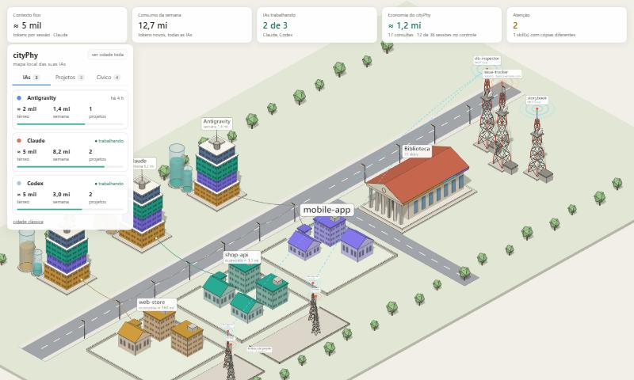
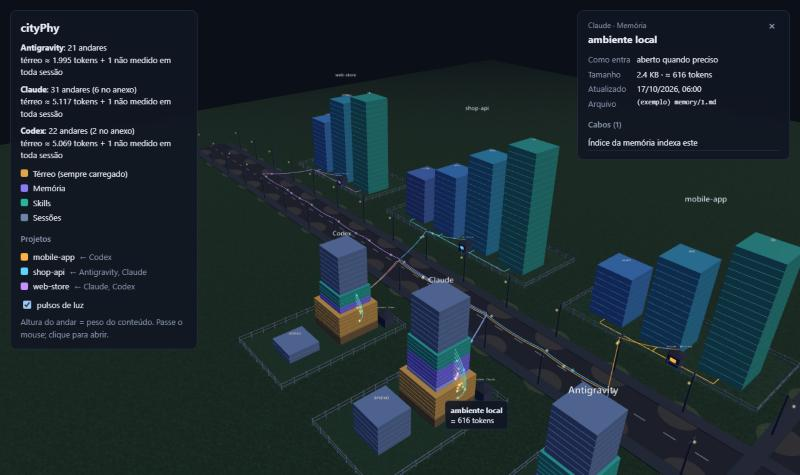
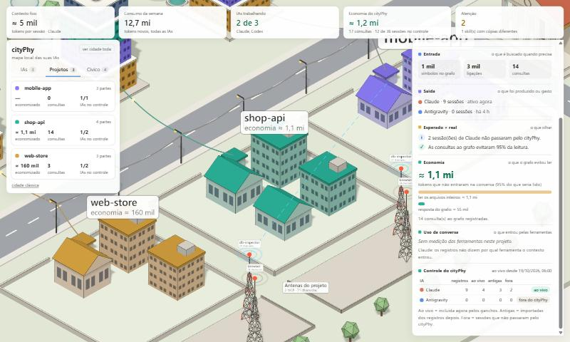
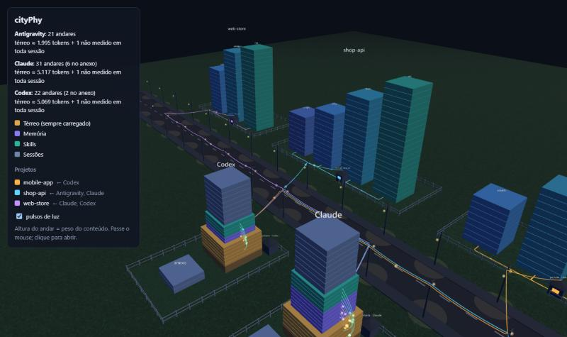
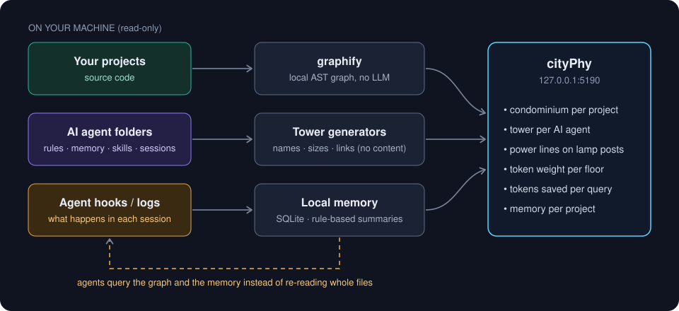

<div align="center">

# cityPhy

**Veja suas IAs pensando, em forma de cidade.**

Uma cidade 3D local do seu código e do que as suas IAs de programação (Claude Code, Codex, Antigravity…) carregam no
contexto. Feita sobre o [graphify](https://github.com/safishamsi/graphify). Tudo fica na sua máquina.

**Português** · [English](README.en.md) · [Como funciona](#como-funciona) · [Instalação](#instalação) · [Comandos](#comandos) ·
[Créditos](CREDITS.md)



<sub>Print do exemplo **fictício** que vem no repositório (`npm run dev:example`): três projetos e três IAs.</sub>

</div>

---

## Por quê

Cada mensagem que você manda para uma IA de programação reenvia **a conversa inteira**. Quando a IA lê cinco arquivos
para responder algo, esses ~20.000 tokens ficam na conversa e são pagos de novo em **toda mensagem depois**.

O cityPhy ataca o que **entra** na conversa:

| Em vez de… | a IA usa… | exemplo medido |
|---|---|---|
| ler arquivos inteiros para achar algo | uma consulta ao **graphify** (grafo local do código) | ≈ 444 tokens devolvidos contra ≈ 8.028 tokens nos 11 arquivos por trás da resposta |
| redescobrir o que foi feito semana passada | a **memória local** do projeto | um resumo curto no início da sessão, com teto de tokens |
| adivinhar para onde vai o contexto | a **cidade**: cada andar do tamanho do seu peso | térreo = o que é pago em toda sessão |

## O que você vê

| Peça | Significado |
|---|---|
| **Torre da IA** (a oeste da rua principal) | uma por IA. **Térreo** = o que ela carrega em *toda* sessão (regras, instruções, índice da memória, lista de skills). Depois memórias, skills e as sessões recentes; as antigas vão para o **anexo**. Altura do andar = peso do conteúdo (≈ tokens). |
| **Condomínio** (a leste da rua) | um lote cercado por projeto, um prédio por pasta de topo, do tamanho do número de arquivos. Cada projeto tem **a sua cor**. |
| **Rede elétrica** | quando uma IA trabalha num projeto, um cabo sai da torre, segue pelos **postes de luz** da calçada, atravessa a rua pelo ar e entra pela **portaria** do projeto; de lá corre pelo chão até cada prédio. Pulsos de luz correm nele na cor do projeto. Nada fica em cima da rua. |
| **Portaria (painel)** | passe o mouse para ver o peso; clique para abrir o painel. |

<table>
<tr>
<td width="50%"><br><sub>Um andar da torre: como entra, ≈ tokens, ligações.</sub></td>
<td width="50%"><br><sub>Um prédio do projeto: arquivos, símbolos, quais IAs alimentam.</sub></td>
</tr>
<tr>
<td colspan="2"><br><sub>Energia pelos postes de luz, uma cor por projeto.</sub></td>
</tr>
</table>

## Como funciona



1. O **graphify** monta o grafo do código de cada projeto pela passagem local por AST (`GRAPHIFY_BACKEND=none`): sem modelo, sem chave de API.
2. Os **geradores de torre** (`src/towers/<ia>/`) leem as pastas de cada IA e gravam um `graph.json` compatível com o
   graphify, com **nomes, tamanhos, datas e ligações**, nunca o conteúdo de memórias ou conversas.
3. A **memória local** (a ideia do [claude-mem](https://github.com/thedotmack/claude-mem), só que no disco): hooks ou
   registros de sessão viram observações curtas num SQLite por projeto, resumidas **por regra, não por um modelo**.
4. O **cityPhy** mostra a cidade em `127.0.0.1:5190`, e as IAs consultam o grafo e a memória em vez de reler arquivos inteiros.

## Requisitos

| Requisito | Para quê | O `setup` instala? |
|---|---|---|
| **Node.js 24+** | roda o cityPhy e os geradores; **já traz o SQLite** (`node:sqlite`) usado pela memória | não — baixe em [nodejs.org](https://nodejs.org) |
| **Python 3.10+** | o graphify é feito em Python | não — baixe em [python.org](https://www.python.org/downloads/) |
| **graphify** (`graphifyy` no PyPI) | monta o grafo do código | **sim, se você permitir** |
| uv ou pipx *(recomendado)* | instala o graphify num ambiente próprio | **sim, se você permitir** |
| Ollama *(opcional)* | modelo local para resumos melhores (planejado) | não — [ollama.com](https://ollama.com) |

O `cityphy setup` confere tudo, mostra o comando exato para o que faltar e **só roda depois que você disser sim**.

## Instalação

```bash
git clone https://github.com/RafaelRodriguesDev/cityPhy.git
cd cityPhy
npm install
```

**Só para ver** — abra a cidade de exemplo fictícia:

```bash
npm run dev:example        # http://127.0.0.1:5190
```

**Para usar com os seus projetos:**

```bash
cp cityphy.config.example.json cityphy.config.json   # liste seus projetos (veja abaixo)
npm run cityphy -- setup     # requisitos + perguntas por projeto + regras das IAs (pergunta antes de cada passo)
npm run refresh              # grafo do graphify de cada projeto + torre de cada IA
npm run dev                  # http://127.0.0.1:5190
```

`cityphy.config.json` (não vai para o git):

```json
{
  "dataDir": "./data",
  "projects": [
    { "name": "shop-api", "path": "C:/codigo/shop-api", "exclude": ["**/node_modules/", "**/dist/"] }
  ]
}
```

- `dataDir`: onde ficam grafos, torres, memória e métricas. Cada projeto tem a sua pasta:

  ```
  <dataDir>/
    shop-api/
      graphify-out/        grafo do graphify
      cityphy/
        project.json       opções escolhidas no setup
        memory.db          memória local (SQLite)
        LESSONS.md         resumo curto para o início da sessão
        metrics.jsonl      uma linha por consulta: tokens devolvidos × evitados
    torre-claude/          torre do Claude
    torre-codex/
  ```
- `exclude` vai para o `graphify extract --exclude`. Se o `graphify` não estiver no `PATH`, defina `GRAPHIFY_BIN`.

## O que o `setup` pergunta (por projeto)

1. Usar o grafo do graphify neste projeto? *(recomendado)*
2. Ligar a memória automática local? *(nada sai da máquina)*
3. Colocar um resumo do trabalho recente no início de cada sessão? Com qual teto? *(padrão 800 tokens)*
4. Registrar a economia de tokens de cada consulta ao grafo?
5. Usar um modelo local (Ollama) para resumos? *(padrão: não)*
6. Pode instalar a skill global `cityphy` em cada IA (`~/.claude/skills`, `~/.codex/skills`, `~/.gemini/config/skills`)?
7. *(Claude Code)* Pode ligar os hooks do cityPhy em `~/.claude/settings.json`? Fora dos projetos do cityPhy eles não fazem nada.

**Nada é escrito dentro dos seus projetos.** A lista de projetos fica só no `cityphy.config.json`, e a IA descobre o projeto pela pasta aberta.

Uma IA com a skill `cityphy` que abre um projeto ainda não registrado para ela pergunta **a você** no chat e depois roda
`cityphy setup --project <p> --agent <id dela> --answers graph=sim,memory=sim,...`.

## Comandos

De qualquer pasta: `node <cityPhy>/bin/cityphy.ts <comando>` (ou `npm run cityphy -- <comando>` dentro do repositório).

| Comando | O que faz |
|---|---|
| `setup [--project P] [--agent A] [--answers k=v,…] [--yes]` | requisitos, perguntas de opt-in, regras das IAs |
| `refresh [--towers]` | grafo de cada projeto + todo gerador de torre |
| `dev` | a cidade em `127.0.0.1:5190` |
| `context [--project P]` | o texto que a IA recebe no início da sessão |
| `query "<pergunta>" [--project P] [--agent A] [--budget N]` | consulta ao graphify + métrica de economia |
| `mem search "<termos>"` · `mem save --note "…"` · `mem stats` · `mem lessons` | a memória local do projeto |
| `hook claude` | hook do Claude Code (lê o evento no stdin) |

## Adicione a torre da sua IA

As torres ficam em `src/towers/<ia>/` — as do Claude e do Antigravity já estão lá. Para outra IA construir a dela, cole
nela o [docs/PROMPT-TORRE.md](docs/PROMPT-TORRE.md). Ela mostra o que achou, espera o seu OK, escreve só na pasta dela e
entrega prova (saída do gerador, typecheck, `graphify explain`). Formato: [docs/TOWER-SCHEMA.md](docs/TOWER-SCHEMA.md).

## Privacidade

- O cityPhy só **lê** as pastas das IAs e os projetos, e serve a página em `127.0.0.1`. Sem telemetria, sem rede.
- As torres guardam nomes, tamanhos, datas e ligações, nunca o conteúdo de mensagens ou memórias.
- O graphify roda só a passagem local por AST. A memória é resumida por regra, na sua máquina.

## Desenvolvimento

```bash
npm run typecheck
npm test               # inclui as regras da cidade: nada na rua, energia só pelos postes de luz
npm run example        # gera de novo o exemplo fictício em examples/data
```

Arquitetura: [docs/ARCHITECTURE.md](docs/ARCHITECTURE.md) · Metáfora: [docs/METAPHOR.md](docs/METAPHOR.md) ·
Notas para IAs: [AGENTS.md](AGENTS.md) · Mudanças: [CHANGELOG.md](CHANGELOG.md)

## Próximos passos

- Painéis com abas: economia por IA e por modelo, memória, opções ligadas, trabalho recente
- Pulsos ao vivo quando uma IA consulta o grafo ou salva uma memória
- Leitores de uso do Codex e do Antigravity (o do Claude está pronto) e o cartório com a memória de cada projeto
- `npx cityphy`

## Créditos

O cityPhy se apoia no trabalho de outras pessoas — veja [CREDITS.md](CREDITS.md). Resumo: o **graphify**, de
[safishamsi](https://github.com/safishamsi/graphify) (MIT), monta os grafos; a memória local segue a ideia do
**claude-mem**, de [thedotmack](https://github.com/thedotmack/claude-mem) (Apache-2.0); desenho com
[Three.js](https://threejs.org) e servidor com [Vite](https://vite.dev) (ambos MIT).

## Licença

[MIT](LICENSE) · feito por **Rafael Rodrigues Dev** · **Lunar Wave**
